<div align="center">


<br>


<br><br>

<b>
<a href="#-simulação-no-whatsapp">💬 Simulação</a> &nbsp;·&nbsp;
<a href="#-recursos">🌸 Recursos</a> &nbsp;·&nbsp;
<a href="#-comandos">📖 Comandos</a> &nbsp;·&nbsp;
<a href="#-instalação">🚀 Instalação</a> &nbsp;·&nbsp;
<a href="#-terminal-da-sakura">🖥️ Terminal</a> &nbsp;·&nbsp;
<a href="#-segurança">🔒 Segurança</a>
</b>

</div>

<br>

> 🪷 **Sakura-MD** (codinome **Hanami**) é um bot de WhatsApp feito em **Node.js (ESM)** sobre um fork do Baileys.
> Menus interativos, figurinhas, downloads, IA com personalidade, economia, jogos, painel web e um console próprio no terminal — tudo em um único projeto, com **um comando por arquivo**.

<br>

## 💬 Simulação no WhatsApp

<table>
<tr>
<td width="420" align="center" valign="top">



<sub>🎞️ animação em loop · <b>simulação ilustrativa</b></sub>

</td>
<td valign="top">

### O que a animação mostra

| # | Mensagem | O que a Sakura faz |
|:-:|---|---|
| 1 | `.menu` | abre o menu interativo com botão |
| 2 | `.menu midia` | lista os comandos de uma categoria |
| 3 | `.play lofi hip hop` | busca no YouTube e envia o áudio |
| 4 | foto + `.s` | devolve uma figurinha |
| 5 | `.calculadora …` | calcula na hora |
| 6 | conversa normal | a IA responde curto e com personalidade |

<br>

> 💡 Todo menu usa o mesmo padrão visual: ícones **💮 / 🌸** alternados por linha, seção em **🪷** e link em **🔗** (fonte única em `data/menu-style.js`).

</td>
</tr>
</table>

<details>
<summary><b>📝 Ver a mesma conversa em texto</b> (caso a animação não carregue)</summary>

<br>

```text
 você ─────────────────────────────
 .menu                        15:52 ✓✓

 Sakura-MD ────────────────────────
 ╭━━⪩ 🪷 *SAKURA-MD* ⪨━━
 ▢ • 💮 Principal
 ▢ • 🌸 Mídia
 ▢ • 💮 Grupo
 ▢ • 🌸 Administração
 ▢ • 💮 Inteligência artificial
 ▢ • 🌸 Economia
 ▢ • 💮 Diversão
 ▢ • 🌸 VIP
 ╰━━─「🪷」─━━
 [ 💮 Abrir menu ]

 você ─────────────────────────────
 .play lofi hip hop           15:52 ✓✓

 Sakura-MD ────────────────────────
 🌸 Buscando no YouTube...
 ▶ ▁▃▅▂▆▃▂▅▇▃▄▂   🎧 áudio enviado

 você ─────────────────────────────
 .calculadora 2 + 2 * (3 + 1) 15:52 ✓✓

 Sakura-MD ────────────────────────
 🌸 Resultado: 10
```

</details>

<br>

## 🌸 Recursos

<table>
<tr>
<td width="33%" valign="top">

### 💮 Menus interativos
Categorias, catálogo completo, pesquisa de comandos, atalhos curtos (`.m`, `.mid`…) e correção de comando digitado errado.

</td>
<td width="33%" valign="top">

### 🌸 Figurinhas
`.s`, `.s20` (até 20 fotos de uma vez), `.brat`, `.take`, `.toimg`/`.tomp4` e uma biblioteca de figurinhas controlada.

</td>
<td width="33%" valign="top">

### 🪷 Downloads
YouTube (`.play`, com fila e cache via **yt-dlp**), TikTok sem cookies, Instagram e Pinterest direto.

</td>
</tr>
<tr>
<td valign="top">

### 💮 IA com personalidade
Provider/modelo configuráveis, **pool rotativo de tokens** e personalidade própria em `config/ai-personality.txt`.

</td>
<td valign="top">

### 🌸 Economia & jogos
Jardim de **Sakura Coins**, ranking, arena **PVP** com rating e XP, jogo da velha, tarot e relacionamentos.

</td>
<td valign="top">

### 🪷 Grupos
Recepção automática com ficha, **AFK**, anti-link, automações, agenda e status do grupo.

</td>
</tr>
<tr>
<td valign="top">

### 💮 VIP & aluguel
Planos VIP com limites e prioridade maiores, contratos de aluguel por tempo e PIX de apoio.

</td>
<td valign="top">

### 🌸 Painel e terminal
Painel web (padrão `127.0.0.1:3000`) e console `sakura›` com autocompletar para configurar tudo sem editar JSON.

</td>
<td valign="top">

### 🪷 Robustez
Backup automático de config/db/auth, filas de envio com prioridade, reparo de sessão Signal e `doctor` de diagnóstico.

</td>
</tr>
</table>

<br>

## 📖 Comandos

> O prefixo padrão é <kbd>.</kbd> e pode ser trocado em `config/sakura.config.json` ou pelo terminal (`prefixo`).
> Dentro do WhatsApp, `.menu`, `.comandos` e `.ajuda` mostram sempre a lista atualizada.

<details open>
<summary><b>🪷 Principal</b></summary>

| Comando | Descrição |
|---|---|
| `.menu` · `.m` · `.ajuda` | abre categorias, catálogos, atalhos e pesquisa |
| `.comandos` | catálogo completo de comandos |
| `.tutorial [categoria]` | explica os sistemas da Sakura em páginas curtas |
| `.calculadora 2 + 2` | soma, subtração, multiplicação, divisão, porcentagem, parênteses e potência |
| `.botinfo` | identidade e informações técnicas |
| `.ping` · `.creditos` | latência · créditos dos áudios e figurinhas |

</details>

<details>
<summary><b>🌸 Mídia</b></summary>

| Comando | Descrição |
|---|---|
| `.play <música ou link>` | busca no YouTube, gerencia fila/cache e baixa o áudio |
| `.tt <link>` | baixa vídeo do TikTok sem cookies |
| `.instagram <link>` · `.pinterest <link>` | baixa mídia pública, sem yt-dlp |
| `.s` · `.s20` | cria figurinha · converte até 20 fotos recentes em fila segura |
| `.toimg` · `.tomp4` | converte figurinha em imagem ou vídeo (respondendo a ela) |
| `.brat <texto> \| rosa \| esquerda` | Brat 1:1 com cor, texto e alinhamento |
| `.tts <voz> \| <texto>` · `.tts vozes` | texto em áudio com vozes Microsoft |
| `.figsorteio` | sorteia uma figurinha da biblioteca |
| `.take [nome]` 💎 | limpa/aplica metadados da figurinha |
| `.pin <busca>` 💎 | busca imagens no Pinterest (`.pinfig` cria pack de até 50) |

</details>

<details>
<summary><b>💮 Grupo & Administração</b></summary>

| Comando | Descrição |
|---|---|
| `.afk [motivo\|off]` | marca você como ausente e avisa quem te mencionar |
| `.recepcao` · `.ficha Nome \| 18 \| Recife` | recepção automática e fichas dos membros |
| `.relacionamento` · `.namorar @pessoa` · `.familia` | sistema social |
| `.acoes` · `.beijar @pessoa` | ações entre membros |
| `.ban @pessoa` | remove membro |
| `.antilink [on\|off\|status]` | proteção de links com painel interativo |
| `.cita` | reenvia a mensagem citada marcando todos |
| `.statusgp <texto>` · `.delstatusgp` | publica / apaga status do grupo |
| `.automacoes` · `.grupo` | automações e ajustes do grupo |

</details>

<details>
<summary><b>🪷 Inteligência artificial</b></summary>

| Comando | Descrição |
|---|---|
| `.ia status` | estado da IA |
| `.autoia on\|off` | IA responde sozinha na conversa |
| `.iaconfig` | provider, modelo, tokens e comportamento |
| `.iatoken add TOKEN` | gerencia o pool rotativo de tokens |

</details>

<details>
<summary><b>💮 Economia, jogos & diversão</b></summary>

| Comando | Descrição |
|---|---|
| `.eco` | jardim de Sakura Coins: conta, rotinas, itens e transferências |
| `.rankdinheiro` | ranking de moedas |
| `.pvp @pessoa` | arena em rodadas com rating, XP, dano, histórico e anti-farm |
| `.velha @pessoa` | jogo da velha |
| `.tarot <pergunta>` | tira 3 cartas em uma imagem e libera a interpretação por botão |
| `.pack [quantidade]` | pacote aleatório com figurinhas já recebidas |

</details>

<details>
<summary><b>🌸 VIP, aluguel & apoio</b></summary>

| Comando | Descrição |
|---|---|
| `.vip 30d @pessoa` · `.vip renovar 2h @pessoa` · `.vip vitalicio @pessoa` | consulta ou administra o Sakura VIP |
| `.figvip semcorte\|quadrada\|redonda\|borda\|texto\|animada` | ferramentas avançadas de figurinha |
| `.c 30d` · `.c renovar 2h` · `.c vitalicio` | contrato de aluguel do bot em um grupo |
| `.doar` | PIX oficial e benefícios por apoio |

</details>

<details>
<summary><b>⚙️ Dono & configuração</b></summary>

| Comando | Descrição |
|---|---|
| `.dono add @pessoa` | gerencia donos e subdonos pelo WhatsApp |
| `.config` | painel central de configurações |
| `.diagnostico` | saúde, filas e runtime |
| `.baileys [cache\|limpargp]` | métricas do socket, caches e relay |
| `.automaticos` | áudios e figurinhas automáticas |
| `.bibliotecafig on\|off\|status\|limpar\|revisar` | biblioteca de figurinhas geradas |
| `.player [status\|teste <música>]` | estado do motor yt-dlp |

</details>

> 💎 = exige **VIP**.

<br>

## 🚀 Instalação

**Requisitos:** Node ≥ 22.5 · npm ≥ 10 · ffmpeg (opcional via `@ffmpeg-installer/ffmpeg`) · sharp (opcional; em ARM use ImageMagick).
Na primeira execução é preciso internet: o `yt-dlp` é baixado para `storage/bin/`.

```bash
git clone <url-do-repositorio> sakura-bot
cd sakura-bot

npm run install:full     # ou: npm run install:core  (sem dependências opcionais)
npm run configure        # donos, tokens e config/sakura.config.json
npm start                # prestart: bootstrap-deps + preflight
```

Na primeira vez aparece um **QR code** no terminal: abra o WhatsApp → *Aparelhos conectados* → *Conectar aparelho*.

| Script | Para quê |
|---|---|
| `npm start` | inicia o bot |
| `npm run dev` | inicia com `--watch` |
| `npm run doctor` | diagnóstico do ambiente |
| `npm run check` | checagem de sintaxe do projeto |
| `npm run panel` | sobe só o painel web |
| `npm run reset-session` | apaga `auth/` e pareia de novo |
| `npm run new:command -- exemplo "Principal"` | gera um comando novo |

<br>

## 🖥️ Terminal da Sakura

Ao rodar `npm start` num terminal, aparece o prompt abaixo. <kbd>Tab</kbd> completa comandos e opções. Para desligar: `SAKURA_NO_CONSOLE=1`.

```text
sakura› assistente
sakura› config ui.footer
sakura› prefixo !
sakura› status
```

| Comando | O que faz |
|---|---|
| `assistente` | configura nome, números, dono, prefixo, IA e painel passo a passo (<kbd>Enter</kbd> mantém o valor) |
| `config` · `config <seção>` · `config <seção.chave> <valor>` | vê e altera opções (segredos aparecem mascarados) |
| `dono` · `prefixo` · `nome` | atalhos de configuração — valem na hora |
| `status` · `grupos` · `enviar` · `auto` | estado, grupos, envio manual e automações |
| `log` · `backup` · `reconectar` · `limpar` · `sair` | manutenção · `ajuda` lista tudo |

<br>

## ⚙️ Configuração

Tudo mora em **um único arquivo**: `config/sakura.config.json`.

| Seção | Conteúdo |
|---|---|
| `bot` · `owners` | identidade, prefixo, release, donos e subdonos |
| `ai` · `tts` | provider, modelo, tokens, limites e vozes |
| `ui` | emojis, rodapé, canal de updates, grupo oficial e imagens do menu |
| `economy` · `games` · `vip` · `donation` | moedas, recompensas, planos e apoio |
| `cache` · `queues` · `runtime` | TTLs, filas, reconexão, logs e retries |
| `panel` · `reception` · `autoDownload` | painel web, recepção e downloads automáticos |

Segredos ficam separados em `config/private/` (chave da IA, senha inicial do painel).

<br>

## 🗂️ Estrutura

```text
.
├── index.js            entrada: restaura backup → abre store → inicia o cliente
├── commands/           um arquivo por comando
├── data/               serviços e lógica (mapa em docs/mapa.md)
│   ├── scripts/        setup, configure, doctor, preflight, testes
│   └── vendor/         fork do Baileys
├── config/             sakura.config.json, personalidade da IA, private/
├── storage/            banco (sakura-db.json), logs, cache, binários
├── auth/               sessão do WhatsApp  ⚠️ secreto
├── backup/             espelho automático (recriado pelo bot)
├── assets/             áudios, figurinhas, menu, tarot
└── docs/               mapa do código e guia de comandos
```

<br>

## 🧪 Testes

```bash
npm test                 # suíte principal
npm run test:menu        # testes por área (veja o package.json)
```

> ⚠️ Vários testes reescrevem `config/sakura.config.json` e `storage/sakura-db.json`. **Rode sempre em uma cópia do projeto.**

<br>

## 🔒 Segurança

Estes caminhos contêm sessão e segredos reais — **nunca vão para o Git** (o `.gitignore` do projeto já os cobre):

| Caminho | Por quê |
|---|---|
| `auth/` | sessão do WhatsApp: quem tiver isso controla o número do bot |
| `config/private/` | chave da IA e senha inicial do painel |
| `backup/` | espelho de `auth/`, config e banco |
| `storage/` | banco de dados, logs e caches |

Se algum desses já foi publicado, **desconecte o aparelho no WhatsApp, rode `npm run reset-session` e troque as chaves**.

<br>

<div align="center">

🌸 💮 🪷 💮 🌸

**Sakura-MD • Drux Domina**

<sub>Créditos dos áudios e figurinhas da base: use <code>.creditos</code> no WhatsApp.</sub>

</div>
